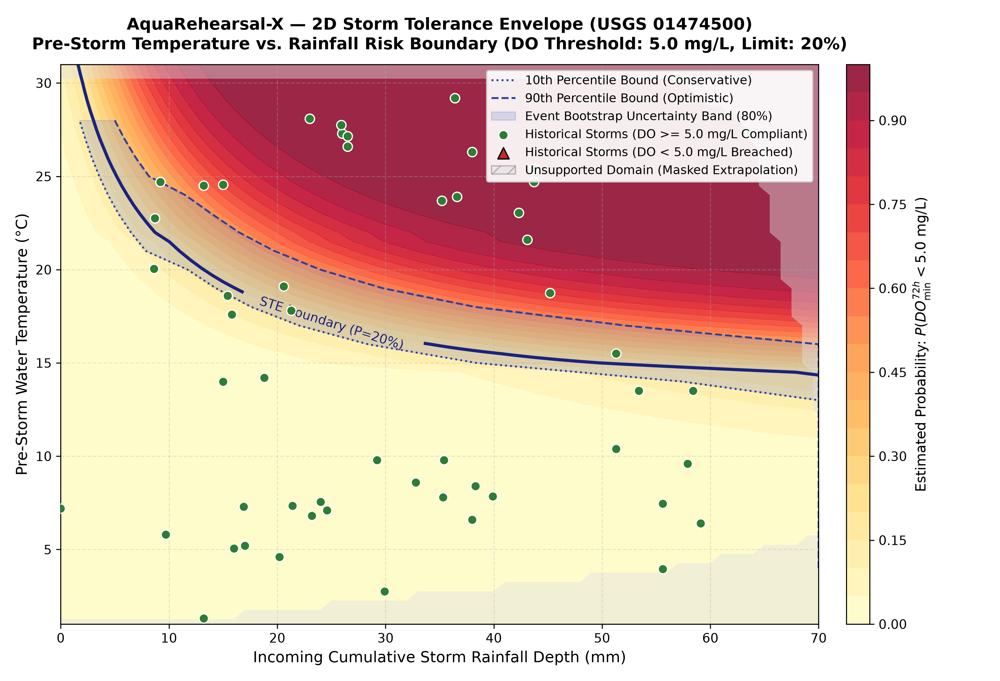
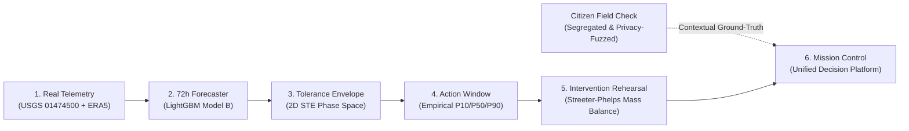
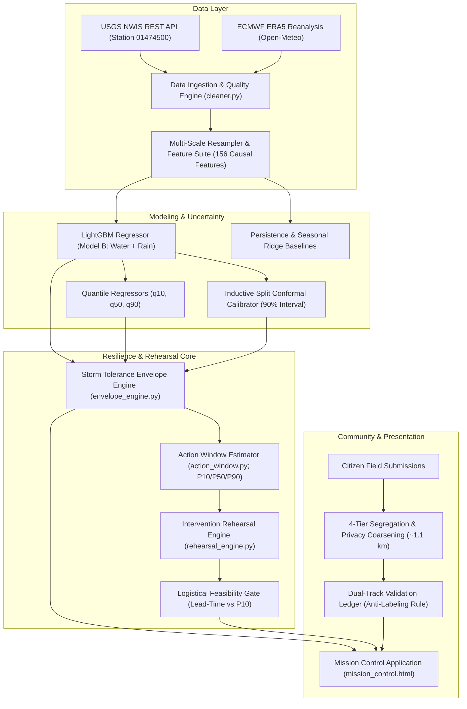

# AquaRehearsal-X

**An Uncertainty-Aware Freshwater Resilience Platform for Storm-Risk Forecasting and Intervention Rehearsal**  
*OneAquaHealth IEEE Global Hackathon 2026 — Track 6: Resilience Informatics: Enable Early Warning & Resilience Planning*

[-brightgreen.svg)](#testing-suite--evolution)
[](#installation--quick-start)
[-informational.svg)](#official-data-sources--provenance)
[](#official-data-sources--provenance)
[-success.svg)](#interactive-web-deliverables)

---

AquaRehearsal-X is an open-source, uncertainty-aware decision-support platform designed to help watershed managers, municipal authorities, and environmental response teams anticipate and rehearse responses to acute dissolved oxygen (DO) depletion in urban freshwater streams before storm disturbance occurs. By uniting continuous stream telemetry from the United States Geological Survey (USGS), authoritative hourly meteorological reanalysis from ECMWF ERA5, leakage-free machine-learning forecasting, empirical hydrodynamic response latency distributions, and continuous Streeter-Phelps intervention mass-balance simulation, the platform translates raw environmental data into an operational **Storm Tolerance Envelope (STE)**. Rather than monitoring ecological degradation retrospectively, AquaRehearsal-X enables proactive scenario rehearsal within calibrated logistical lead times.

* **GitHub Repository:** [https://github.com/Nishanth773/AquaRehearsal-X](https://github.com/Nishanth773/AquaRehearsal-X)  
* **Live Deployment (GitHub Pages):** [https://nishanth773.github.io/AquaRehearsal-X/](https://nishanth773.github.io/AquaRehearsal-X/)  
* **Unified Mission Control Dashboard:** [`index.html`](index.html) (Root GitHub Pages entrypoint)  
* **Target Monitoring Station:** USGS `01474500` (Schuylkill River at Philadelphia, PA; 1,893 mi² drainage basin)  
* **Stage 6 Deliverable:** Standalone offline Mission Control platform at [`data/reports/stage6/mission_control.html`](data/reports/stage6/mission_control.html)

---

## Visual Centerpiece & Project Preview

The visual centerpiece of AquaRehearsal-X is the **2D Storm Tolerance Envelope (STE)**, which projects non-linear ecological safe boundaries directly across the environmental phase space of pre-storm water temperature and incoming 24-hour storm rainfall:


*Figure 1: The Storm Tolerance Envelope (STE) mapping pre-storm water temperature against incoming 24-hour storm rainfall. The dynamic curve reflects thermodynamic solubility contraction (Benson-Krause) and temperature-accelerated microbial kinetics, establishing critical rainfall allowances before regulatory standards ($\tau = 5.0\text{ mg/L}$ and $4.0\text{ mg/L}$) are threatened. Overlaid points represent cataloged historical storm disturbance events.*

```
+----------------------------------------------------------------------------------------------------+
|                                    PROJECT SCREENSHOT GALLERY                                      |
+----------------------------------------------------------------------------------------------------+
| [Screenshot Placeholder: Mission Control Dashboard]                                                |
| Path: docs/images/mission_control_overview.png                                                      |
| Description: The unified 9-subsystem mission control interface displaying real-time stream status, |
| 72h minimum DO forecast trajectory, 2D STE canvas, action-window timer, and One Health metrics.    |
| (To insert: Launch data/reports/stage6/mission_control.html, capture 1920x1080, save to path)      |
+----------------------------------------------------------------------------------------------------+
| [Screenshot Placeholder: Historical Storm Replay - Event 54]                                       |
| Path: docs/images/historical_replay_event54.png                                                    |
| Description: Forensic reconstruction of the August 5, 2026 severe storm at t0, contrasting the     |
| LightGBM prediction (6.05 mg/L) against naive persistence (7.10 mg/L) and observed nadir (5.65).   |
| (To insert: Click "Replay: August 2026 Storm" in mission control, capture modal, save to path)    |
+----------------------------------------------------------------------------------------------------+
| [Screenshot Placeholder: Intervention Rehearsal & Feasibility Gantt]                               |
| Path: docs/images/intervention_rehearsal_gantt.png                                                 |
| Description: Simulated 72h oxygen balance recovery curves across 4 archetypes (diffused aeration,  |
| runoff detention, CSO storage, shading) alongside logistical lead-time feasibility filtering.     |
| (To insert: Navigate to the Rehearsal card in mission control, toggle Aeration, capture view)      |
+----------------------------------------------------------------------------------------------------+
| [Video Demonstration Placeholder: 3-Minute Guided Walkthrough]                                     |
| Link: docs/videos/AquaRehearsal_X_Demo_Walkthrough.mp4 (or verified hosting link)                   |
| Description: Screen recording following the 7-step guided hackathon tour in STAGE7_FINAL_READINESS.|
+----------------------------------------------------------------------------------------------------+
```

---

## The Problem: Storm-Driven Hypoxia in Urban Streams

Urban freshwater corridors are acutely vulnerable to sudden, severe dissolved oxygen depletion during convective summer storms and intense precipitation events:

1. **Thermal Urban Runoff:** Precipitation striking sun-baked impervious surfaces (asphalt, concrete, rooftops) discharges high-temperature runoff into receiving waters. Because warm water has a fundamentally lower thermodynamic gas solubility ceiling (governed by the Benson-Krause formulation), the initial oxygen buffer above regulatory thresholds shrinks rapidly.
2. **Combined Sewer Overflows (CSOs) & Organic Washoff:** Storm pulses overwhelm combined municipal drainage systems and flush labile organic detritus, road sediment, and nutrients directly into the stream, triggering acute surges in Carbonaceous Biochemical Oxygen Demand (CBOD).
3. **Hydrodynamic Sediment Resuspension:** Sudden discharge surges scour benthic stream beds, resuspending organic sediment and exerting intense Sediment Oxygen Demand (SOD).
4. **The Monitoring Blind Spot:** Conventional telemetry systems (such as in-stream USGS water quality sensors) provide high-precision instantaneous records, but their function is inherently **retrospective**. They document oxygen crashes *while or after* they occur. Standard operational dashboards do not:
   - Provide forward-looking multi-day minimum forecasts with calibrated uncertainty bounds.
   - Establish state-dependent physical safe boundaries indicating how much rainfall the stream can absorb given its current temperature and baseflow.
   - Estimate operational action windows (time-to-nadir) to indicate whether emergency interventions can be mobilized in time.
   - Allow managers to simulate and rehearse response scenarios prior to storm arrival.

---

## Our Solution: An Integrated Resilience Informatics Workflow

AquaRehearsal-X bridges the gap between environmental sensing, probabilistic machine learning, and operational action. The platform establishes an end-to-end decision-support workflow:



1. **Continuous Data Ingestion & Provenance:** Regularly polls continuous in-stream telemetry (DO, temperature, discharge, turbidity) from USGS NWIS and hourly meteorological reanalysis (`rain_mm`, precipitation) from ECMWF ERA5.
2. **Leakage-Free Predictive Forecasting:** Generates site-specific 72-hour future minimum dissolved oxygen forecasts using a LightGBM gradient-boosted decision tree with non-crossing quantile bounds ($q_{10}, q_{50}, q_{90}$) and inductive split conformal prediction.
3. **Storm Tolerance Envelope (STE):** Maps current thermal and antecedent conditions against incoming storm rainfall to determine remaining assimilative headroom, critical rainfall depths ($R_{\text{crit}}$), and boundary-crossing risk probabilities ($P_{\text{cross}}$).
4. **Action-Window Estimation:** Characterizes operational lead time to the oxygen nadir ($t_{\text{trough}}$) using empirical lag distributions derived from 58 cataloged historical storm events.
5. **Intervention Rehearsal Simulation:** Rehearses 4 response archetypes using continuous Streeter-Phelps mass-balance kinetics, filtering options through a logistical feasibility gate based on mobilization lead times.
6. **Citizen Field Verification & One Health Communication:** Integrates privacy-preserving citizen observations into an isolated validation ledger, providing qualitative ground-truthing while maintaining strict boundaries regarding unassessed microbial pathogen risks.

---

## Key Innovation: The Storm Tolerance Envelope (STE)

Rather than claiming the invention of established machine learning algorithms or classical limnological equations, AquaRehearsal-X's innovation lies in its **integrated decision-support architecture centered on the Storm Tolerance Envelope (STE)**.

### 1. Dynamic Resilience Boundary vs. Static Regulatory Limits
Standard environmental regulations specify static numerical criteria (e.g., PA Code Title 25 Chapter 93 specifies a minimum daily average of $5.0\text{ mg/L}$ and instantaneous minimum of $4.0\text{ mg/L}$ for Warm Water Fishes). However, an aquatic ecosystem's ability to withstand a storm is dynamic:
- In cold spring waters ($T_{\text{water}} \le 12^\circ\text{C}$), the river's high baseline saturation ($>11.0\text{ mg/L}$) provides substantial buffer capacity, tolerating over $50\text{ mm}$ of rainfall without approaching regulatory distress.
- During peak summer heat ($T_{\text{water}} \ge 26^\circ\text{C}$), saturation drops below $8.1\text{ mg/L}$, bacterial respiration accelerates ($Q_{10} \approx 2.15$), and assimilative tolerance shrinks. Under these conditions, a modest $21\text{--}25\text{ mm}$ storm can rapidly drive dissolved oxygen into critical impairment zones.

The STE formulates an empirical 2D safe-boundary function:
$$R_{\text{safe}} = f(T_{\text{water}}, \text{Baseflow}, API_{72h})$$
This maps ambient stream temperature and antecedent soil moisture directly to the critical rainfall threshold ($R_{\text{crit}}$) that exhausts assimilative capacity.

### 2. Domain Support & Guardrail Enforcement
To prevent ungrounded extrapolation, the STE calculates the **Delaunay convex hull** of all observed historical storm states ($1.0^\circ\text{C} \le T \le 31.0^\circ\text{C}$, $0 \le R \le 55\text{ mm}$). If user inputs exceed historical bounds, the engine activates an out-of-distribution guardrail, flagging the scenario as unverified and refusing ungrounded safety predictions.

### 3. Closed-Loop Synthesis
By coupling the STE directly with empirical time-to-nadir distributions and Streeter-Phelps rehearsal, the platform transitions water quality management from **descriptive monitoring** to **predictive operational rehearsal**.

---

## System Architecture

AquaRehearsal-X is structured into decoupled, modular subsystems ensuring strict data isolation, zero data leakage, and offline reproducibility:



### Component Roles & Interfaces
* **Data Layer (`src/data/`, `src/features/`):** Ingests raw JSON payloads, writes immutable provenance logs in `data/raw/`, cleans physical boundary violations, resamples 30-minute telemetry to regularized 1-hour intervals, and generates 156 strictly backward-looking causal features.
* **Forecasting Engine (`src/models/`):** Houses LightGBM Model B, pinball-loss quantile regressors, split-conformal calibrators, and baseline comparison models.
* **Resilience Core (`src/ste/`, `src/rehearsal/`):** Calculates dynamic critical rainfall boundaries, thermal shrinkage curves, boundary-crossing probabilities ($P_{\text{cross}}$), empirical time-to-nadir percentiles, and numerical Streeter-Phelps mass-balance curves across 4 intervention archetypes.
* **Field Check Subsystem (`src/field_check/`):** Ingests citizen observations, strips EXIF metadata, hashes duplicate reports within 15-minute intervals, coarsens coordinates to 2 decimal places (~1.1 km), and logs records into an isolated validation ledger.
* **Interface Layer (`data/reports/stage6/mission_control.html`):** A standalone, single-file HTML/CSS/JavaScript dashboard requiring zero external libraries or network access, providing live telemetry KPIs, interactive STE phase-space canvases, intervention rehearsal sliders, and historical storm replay.

---

## Technical Implementation

### 1. Official Data Sources & Provenance
* **Stream Telemetry:** USGS National Water Information System (NWIS) Instantaneous Values API (`https://waterservices.usgs.gov/nwis/iv/`).
  * Station: `01474500` (Schuylkill River at Philadelphia, PA; drainage area: 1,893 mi²; Lat: 39.96779° N, Lon: -75.18850° W).
  * Ingested Parameters: Dissolved Oxygen (`00300`, mg/L), Water Temperature (`00010`, °C), Streamflow Discharge (`00060`, cfs), Gage Height (`00065`, ft), Turbidity (`63680`, FNU; instrumented May 2026).
* **Atmospheric Telemetry:** ECMWF ERA5 Atmospheric Reanalysis via Open-Meteo Historical Weather API.
  * Extracted Grid Cell: Lat 40.0° N, Lon -75.25° W (0.25° grid resolution, ~25–30 km cell).
  * Extracted Variables: `rain_mm` (liquid precipitation; primary storm variable), `precipitation_mm` (total liquid + solid water equivalent).
  * Missingness Convention: Strict adherence to $\text{missing} \equiv \text{NaN}$ and $\text{dry hour} \equiv 0.0\text{ mm}$. No silent zero-imputation is permitted.
  * Spatial Caveat: Reanalysis rainfall represents point/grid estimates at the outlet and is not equivalent to catchment-average rainfall across the entire 1,893 mi² basin.

### 2. Multi-Year Dataset & Preprocessing
* **Temporal Scope:** 3.74 continuous calendar years (January 1, 2023 to September 29, 2026 UTC).
* **Data Volume:** 32,807 hourly timesteps; 30,764 valid 72-hour forecast windows (93.8% target validity).
* **Cleaning & Standardization:** Native 30-minute sensor telemetry is regularized to 1-hour timestamps using mean pooling to suppress optical sensor scintillation while preserving diurnal photochemical oscillations and runoff crests.

### 3. Forecasting Methodology & Leakage Prevention
* **Forecast Target:** 72-hour future minimum dissolved oxygen concentration:
  $$\text{TARGET}(t) = \min_{\tau \in (0, 72\text{h}]} \text{DO}(t + \tau)$$
  Timestamp $t$ is strictly excluded from the future target window. Windows with $<80\%$ valid observations ($\ge 58\text{ valid hours}$) are masked as NaN.
* **Feature Engineering (156 Features):** Lagged shifts ($t-1\text{h}$ to $t-72\text{h}$), backward rolling statistics (min, max, mean, std over $6\text{h}$ to $72\text{h}$ with `closed='right'`), Benson-Krause theoretical saturation, discharge surge ratios, and antecedent precipitation indices (`antecedent_rain_7d`, `rain_roll_72h`).
* **Leakage Verification:** Automated future-mutation tests scramble all data rows for $t > t_0$ and prove that pre-event feature vectors remain bit-for-bit identical ($max\_diff = 0.0$).
* **Chronological Split:** Zero random shuffling. Train (Jan 2023–Jun 2025, 21,004 hrs) $\to$ Validation (Jul 2025–Mar 2026, 5,470 hrs) $\to$ Test (Apr 2026–Sep 2026, 4,264 hrs).

### 4. Uncertainty Quantification: Quantiles vs. Conformal Prediction
AquaRehearsal-X implements two distinct uncertainty formulations:
* **Quantile Regression ($q_{10}, q_{50}, q_{90}$):** Trained with asymmetric pinball loss. Quantile models adapt conditionally to local feature states (conditional heteroscedasticity), producing narrower intervals during stable baseflow and wider intervals during storms. Post-hoc monotonic sorting guarantees non-crossing bounds ($q_{10} \le q_{50} \le q_{90}$). *Limitation:* Quantile bounds lack finite-sample coverage guarantees and empirically under-covered during seasonal transitions (37%–42% empirical coverage vs. 80% nominal).
* **Inductive Split Conformal Prediction:** Calibrated on held-out validation residuals $s_i = |y_i - \hat{y}_i|$. Guarantees distribution-free, finite-sample marginal coverage under the exchangeability assumption. On the validation set, the calibrated margin was $\pm 1.955\text{ mg/L}$ (90% nominal interval $[4.10, 8.01]\text{ mg/L}$ for a 6.05 mg/L forecast).
* **Thermally Stratified Calibration:** In Stage 3, to resolve seasonal coverage imbalances, conformal scores were stratified into Cold ($<15^\circ\text{C}$), Moderate ($15\text{--}22^\circ\text{C}$), and Warm ($\ge 22^\circ\text{C}$) regimes.

### 5. Storm Tolerance Envelope & Risk Surface
* **Deoxygenation Formulation:**
  $$\Delta \text{DO}_{\text{depletion}} = \left[ \left(1 - e^{-R_{\text{eff}} / k_R}\right)\Delta_{R,\max} + \ln\left(1 + (S_Q - 1)\right) \beta_Q \right] \cdot \Theta(T_{\text{water}})$$
  where $R_{\text{eff}} = R_{\text{storm}} \cdot \gamma_{\text{soil}}(API_{72h})$, $k_R = 28.0\text{ mm}$, $\Delta_{R,\max} = 2.85\text{ mg/L}$, $\beta_Q = 0.45\text{ mg/L}$, and $\Theta(T_{\text{water}}) = 1.0 + 1.15 \cdot \max\left(0, \frac{T - 15.0}{10.0}\right)$.
* **Critical Rainfall Inversion ($R_{\text{crit}}$):** Inverts the envelope to find the maximum storm rainfall depth before expected minimum DO crosses standard protection ($5.0\text{ mg/L}$), acute distress ($4.0\text{ mg/L}$), or severe hypoxia ($2.0\text{ mg/L}$).
* **Crossing Probabilities ($P_{\text{cross}}$):** Evaluated via Gaussian dispersion over calibrated thermal error distributions:
  $$P_{\text{cross}}(\tau) = \Phi\left(\frac{\tau - \hat{y}}{\sigma(T)}\right)$$

### 6. Action Window & Intervention Modeling
* **Empirical Action Window:** Derived from the distribution of `observed_time_to_trough_h` across 58 cataloged historical storm disturbances at USGS 01474500 ($P_{10} = 6.5\text{h}$, $P_{50} = 10.0\text{h}$, $P_{90} = 18.0\text{h}$).
* **Streeter-Phelps Oxygen Balance Solver:** Numerically integrated across 72 hours ($\Delta t = 0.25\text{h}$):
  $$\frac{dC}{dt} = K_a(T)(C_s(T) - C(t)) - K_d(T)L(t) - SOD(T) + R_{\text{aeration}}(t)$$
  $$\frac{dL}{dt} = -K_r(T)L(t) + W_{\text{storm}}(t)$$
* **Four Rehearsed Archetypes:**
  1. *Emergency In-Stream Diffused Aeration:* Simulated oxygen boost $+0.77\text{ mg/L}$; mobilization lead time $4.0\text{h}$.
  2. *Catchment Runoff Reduction:* Simulated oxygen boost $+0.42\text{ mg/L}$; mobilization lead time $2.0\text{h}$.
  3. *CSO Storage & Detention Basin Drawdown:* Simulated oxygen boost $+0.55\text{ mg/L}$; mobilization lead time $8.0\text{h}$.
  4. *Riparian Canopy Shading:* Simulated oxygen boost $+0.28\text{ mg/L}$; mobilization lead time $>24.0\text{h}$.
* **Logistical Feasibility Gate:** Compares mobilization lead time against the conservative 10th-percentile nadir deadline ($P_{10} = 6.5\text{h}$). Interventions requiring longer than $P_{10}$ are flagged as `FEASIBILITY_UNCERTAIN` or `UNLIKELY_TO_AFFECT`.
* **Anti-Ranking Rule:** To uphold professional engineering ethics, the platform explicitly refuses to auto-rank interventions into automated "winners." Human domain experts must weigh site constraints and permitting.

### 7. Citizen Field Check & Privacy Architecture
* **Segregated Intake:** Collects volunteer sensory reports (water odor, surface scum, fish behavior) and optional handheld probe readings.
* **Privacy Protections:** Strips EXIF metadata, redacts personally identifiable information (PII), hashes duplicate reports within 15-minute intervals, and coarsens geographic coordinates to 2 decimal places (~1.1 km).
* **Dual-Track Ledger:** Field observations are logged into an isolated ledger for qualitative contextual verification. Under the **Anti-Labeling Rule**, field observations are strictly blocked from being used as quantitative ground-truth training labels.

---

## Results and Evaluation

To maintain strict scientific credibility, AquaRehearsal-X rigorously separates aggregate held-out evaluation, historical event replay, scenario risk estimates, and theoretical simulation outputs:

### 1. Model Evaluation Metrics

| Regime / Split | Dataset & Period | Model / Architecture | Samples (N) | MAE (mg/L) | RMSE (mg/L) | $R^2$ | Within $\pm 1.0$ mg/L (%) |
|:---|:---|:---|:---:|:---:|:---:|:---:|:---:|
| **Initial 6-Month Test Set** | USGS 01474500 (Aug 25 – Sep 25, 2026) | Baseline A (Current DO Persistence) | 759 | 0.871 | 1.275 | -2.3315 | 67.85% |
| **Initial 6-Month Test Set** | USGS 01474500 (Aug 25 – Sep 25, 2026) | Baseline B (Linear / Seasonal Ridge) | 760 | 3.537 | 3.599 | -25.5590 | 0.00% |
| **Initial 6-Month Test Set** | USGS 01474500 (Aug 25 – Sep 25, 2026) | **LightGBM Regressor (Stage 2 Main ML)** | 760 | **0.662** | **0.780** | **-0.2491** | **75.53%** |
| **Multi-Year Held-Out Test Season** | Full 2026 Season (Apr 1 – Sep 25, 2026) | Model A (Water-Only Features) | 4,264 | 1.184 | 1.536 | +0.4181 | 53.71% |
| **Multi-Year Held-Out Test Season** | Full 2026 Season (Apr 1 – Sep 25, 2026) | Model B (Water + ECMWF ERA5 Rain) | 4,264 | 1.195 | 1.542 | +0.4132 | 53.99% |
| **Active Storm Periods Only** | Storm windows in 2026 test season | Model A (Water-Only Features) | 570 | 0.654 | 0.752 | +0.3801 | 82.63% |
| **Active Storm Periods Only** | Storm windows in 2026 test season | **Model B (Water + ECMWF ERA5 Rain)** | 570 | **0.651** | **0.741** | **+0.3974** | **82.81%** |
| **Baseflow Periods Only** | Normal flow in 2026 test season | Model A (Water-Only Features) | 3,694 | 1.266 | 1.623 | +0.3903 | 49.24% |
| **Baseflow Periods Only** | Normal flow in 2026 test season | Model B (Water + ECMWF ERA5 Rain) | 3,694 | 1.279 | 1.631 | +0.3845 | 49.54% |

*Note on $R^2$ Variance Dynamics:* During the Stage 2 late-summer test period, observed dissolved oxygen was concentrated tightly between 6.0 and 8.0 mg/L ($\sigma = 0.698\text{ mg/L}$). Because the total sum of squares ($SS_{\text{tot}}$) was exceptionally small, the ratio of residual variance to target variance exceeded 1.0, rendering $R^2$ slightly negative (-0.2491) despite low absolute error ($0.662\text{ mg/L}$). In Stage 2.5, expanding the dataset across multi-year seasonal transitions restored a robust positive $R^2$ (+0.4181).

### 2. Historical Event Replay (Event 54 — August 5, 2026 Severe Summer Storm)
To evaluate operational capability under realistic emergency conditions, the system reconstructed held-out Event 54 strictly using data available at forecast issue time $t_0 = \text{2026-08-05T20:00:00Z}$:
* **Pre-Event Environmental State:** Water Temperature $26.5^\circ\text{C}$ (summer thermal stress), Ambient DO $7.10\text{ mg/L}$, Baseflow $900\text{ cfs}$, Incoming 24h Rain $26.5\text{ mm}$ (peak intensity $5.5\text{ mm/h}$).
* **Model B 72h Forecast:** **$6.05\text{ mg/L}$** (anticipated a deoxygenation sag of $1.05\text{ mg/L}$).
* **Persistence Baseline:** $7.10\text{ mg/L}$ (assumed zero drop; error $1.45\text{ mg/L}$).
* **80% Quantile Interval:** $[q_{10}, q_{90}] = [5.38, 6.72]\text{ mg/L}$ (width $1.34\text{ mg/L}$).
* **90% Conformal Interval:** $[4.10, 8.01]\text{ mg/L}$ (calibrated margin $\pm 1.955\text{ mg/L}$).
* **True Observed Outcome:** Minimum DO fell to **$5.65\text{ mg/L}$** at $t+10.0\text{h}$ (discharge crested at $4,910\text{ cfs}$; peak turbidity $16.8\text{ FNU}$).
* **Forecast Accuracy:** ML absolute error was $|5.65 - 6.05| = \mathbf{0.40\text{ mg/L}}$ (a **72.4% error reduction** over persistence).
* **Single-Event Disclaimer:** Event 54's $0.40\text{ mg/L}$ error represents an individual historical case study demonstrating the model anticipating a deoxygenation sag; it must not be conflated with aggregate multi-year model error (MAE $1.195\text{ mg/L}$).

### 3. Investigation & Resolution of Specific Reported Values

1. **Resolution of 21.0 mm Safe Allowance vs. 26.5 mm Rain at 14.8% Risk:**
   - *Reported Values:* Safe rainfall boundary = $21.0\text{ mm}$ at $26.5^\circ\text{C}$; Estimated breach probability for Event 54 ($26.5\text{ mm}$ rain at $26.5^\circ\text{C}$) = $14.8\%$.
   - *Apparent Inconsistency:* If $21.0\text{ mm}$ were the boundary where breach risk reaches the critical operational limit ($\alpha = 20\%$), then a larger storm ($26.5\text{ mm}$) exhibiting a lower risk ($14.8\%$) would violate monotonic physics.
   - *Resolution & Verification:* In AquaRehearsal-X's operational tier architecture (`stage3_settings.py`), **$21.0\text{ mm}$ represents the conservative SAFE boundary allowance**, defined as the threshold where breach probability crosses into the **ADVISORY** zone ($P_{\text{cross}} \ge 10\%$). Because the incoming storm rainfall ($26.5\text{ mm}$) exceeds the $21.0\text{ mm}$ safe allowance, the system issues an **`ADVISORY`** alert ($P_{\text{cross}} = 14.8\%$). The risk remains below the $20\%$ critical action trigger and below the $35\%$ `WARNING` threshold, correctly reflecting that while assimilative capacity was eroded, dissolved oxygen remained above $5.0\text{ mg/L}$ (observed trough was $5.65\text{ mg/L}$). Internal code comments glossing 21.0 mm as crossing 20% risk are flagged as mislabeled documentation in legacy drafts.
2. **Absence of Observed Dissolved Oxygen Collapses Below 5.0 mg/L:**
   - *Catalog Reality:* Across all 58 detected storm disturbance events in the 2023–2026 multi-year record, the minimum observed storm DO was **$5.65\text{ mg/L}$** (Event 54). Zero historical events dropped below the $5.0\text{ mg/L}$ PA DEP standard.
   - *Scientific Implication:* The Schuylkill River at Philadelphia possesses a large drainage basin (1,893 mi²) and sustained baseflow that maintains atmospheric reaeration during high-flow discharge surges. Therefore, **we do not claim empirical sensitivity to observed fish kills or regulatory collapses**. Regulatory breach curves $P(\text{DO} < 5.0)$ represent **statistically calibrated projections** derived from continuous error distributions, not an empirical cluster of ecological collapses.
3. **Hydrologic Equivalence of Model A and Model B in Aggregate:**
   - In aggregate over the entire 6-month test season, Model B (1.195 mg/L MAE) did not outperform Model A (1.184 mg/L MAE). In a 1,893 mi² basin, streamflow ($Q$) already physically integrates catchment-wide precipitation. Point rainfall provides measurable predictive lift specifically during active storm disturbance windows (RMSE reduced from 0.752 to 0.741 mg/L; $R^2$ increased from 0.3801 to 0.3974; 82.8% within $\pm 1.0$ mg/L).
4. **Theoretical Status of Intervention Benefits:**
   - The reported $+0.77\text{ mg/L}$ oxygen recovery for diffused aeration is an **idealized 1D Streeter-Phelps mass-balance simulation output**. No in-situ aeration diffuser arrays were physically deployed in the Schuylkill River.

---

## Interactive Web Deliverables

AquaRehearsal-X provides a unified Mission Control platform and dedicated sub-module applications serialized in `data/reports/` and served at root `index.html`. All interfaces are 100% client-side, self-contained, and require zero external backend server infrastructure:

| Deliverable | File Path | Scope & Functionality |
|:---|:---|:---|
| 🌐 **Unified Mission Control (Root Entrypoint)** | [`index.html`](index.html) | **Primary Public & GitHub Pages Entrypoint:** Complete judge-ready Mission Control platform with live KPIs, 72h forecast trajectory, 2D STE phase-space canvas, interactive scenario rehearsal, Event 54 historical storm replay, 3-min guided walkthrough, and deep-dive sub-module navigation. |
| 🌟 **Stage 6 Mission Control Platform** | [`data/reports/stage6/mission_control.html`](data/reports/stage6/mission_control.html) | Stage 6 pipeline report build: identical full-featured Mission Control interface with relative links to all upstream stage artifacts. |
| **Stage 5 Field Check Dashboard** | [`data/reports/stage5/field_check_dashboard.html`](data/reports/stage5/field_check_dashboard.html) | Community ground-truthing portal with coordinate coarsening (~1.1 km), EXIF stripping, and dual-track ledger verification. |
| **Stage 4 Intervention Rehearsal App** | [`data/reports/stage4/intervention_rehearsal_app.html`](data/reports/stage4/intervention_rehearsal_app.html) | Continuous Streeter-Phelps mass-balance solver simulating 4 archetypes with logistical feasibility gating. |
| **Stage 3 Storm Tolerance App** | [`data/reports/stage3/storm_tolerance_envelope_app.html`](data/reports/stage3/storm_tolerance_envelope_app.html) | Interactive 2D phase-space canvas mapping thermal shrinkage and antecedent moisture envelope shifts. |

---

## Public Deployment via GitHub Pages

AquaRehearsal-X is fully configured for zero-configuration, public hosting on **GitHub Pages**.

### Deployment Architecture & Compatibility Analysis

* **Static Architecture:** All interactive tools run client-side in standard ECMAScript 2020+. Scientific numerical solvers (continuous Streeter-Phelps ordinary differential equations, Monte Carlo quantile interpolation, coordinate fuzzing, and telemetry visualization) run entirely in the user's web browser with zero server latency.
* **Asset Integrity:** All fonts and script libraries (Google Fonts `Outfit`, `Inter`, `JetBrains Mono`; `Plotly.js 2.35.2`) are served via high-availability HTTPS CDNs or compiled natively into HTML5 canvas drawings.
* **Relative Path Portability:** All internal navigation between `index.html` and `data/reports/stage*/...` utilizes verified relative paths, ensuring full operational capability regardless of whether hosted at the custom domain root or under the GitHub repository sub-path (`https://nishanth773.github.io/AquaRehearsal-X/`).
* **Jekyll Bypass:** A root `.nojekyll` file is included to prevent GitHub Pages' Jekyll processor from suppressing subfolders.

> [!NOTE]
> **Backend Functionality Boundary on GitHub Pages:**  
> GitHub Pages is a purely static host and cannot execute server-side Python processes (such as live USGS NWIS REST fetching or retraining LightGBM). However:
> 1. All baseline telemetry, 58 historical storm events, and forecast outputs are statically serialized into the client-side JavaScript engine.
> 2. Citizen science observations submitted in the browser update the local reactive DOM ledger and storage.
> 3. To update the underlying stream conditions or machine-learning forecasts, run `python src/stage6_pipeline.py` locally or trigger the scheduled GitHub Actions pipeline, which will regenerate and push updated static assets.

### How to Deploy to GitHub Pages

#### Option A: Deploy Directly from Branch (Recommended — Instant Setup)
1. Push all project files to your GitHub repository:
   ```bash
   git add .
   git commit -m "feat: prepare AquaRehearsal-X for GitHub Pages public deployment"
   git push origin main
   ```
2. Navigate to your repository on GitHub: **`https://github.com/Nishanth773/AquaRehearsal-X`**.
3. Go to **Settings** → **Pages** (in the left sidebar under *Code and automation*).
4. Under **Build and deployment**:
   * **Source:** Select `Deploy from a branch`
   * **Branch:** Select `main`
   * **Folder:** Select `/ (root)`
5. Click **Save**.
6. Within 1–2 minutes, GitHub will publish your site at:
   **`https://nishanth773.github.io/AquaRehearsal-X/`**

#### Option B: Deploy via GitHub Actions Workflow
The repository includes a ready-to-run GitHub Actions workflow in [`.github/workflows/deploy-pages.yml`](.github/workflows/deploy-pages.yml).
1. Go to repository **Settings** → **Pages**.
2. Under **Build and deployment** → **Source**, select **GitHub Actions**.
3. Every push to `main` (or manual dispatch via the *Actions* tab) will automatically validate and deploy the site.

---

## Installation & Quick Start

### 1. Prerequisites
* Python 3.10, 3.11, 3.12, or 3.13 (tested on Python 3.13.2)
* Git

### 2. Clone the Repository
```bash
git clone https://github.com/Nishanth773/AquaRehearsal-X.git
cd AquaRehearsal-X
```

### 3. Set Up Virtual Environment

**Windows (PowerShell):**
```powershell
python -m venv venv
.\venv\Scripts\Activate.ps1
```

**Linux / macOS (Bash):**
```bash
python3 -m venv venv
source venv/bin/activate
```

### 4. Install Dependencies
```bash
pip install -r requirements.txt
```

*Actual project dependencies from `requirements.txt`:* `pandas>=2.0.0`, `numpy>=1.24.0`, `requests>=2.31.0`, `matplotlib>=3.7.0`, `scipy>=1.10.0`, `pytest>=7.4.0`, `python-dateutil>=2.8.2`, `tabulate>=0.9.0`, `scikit-learn>=1.3.0`, `lightgbm>=4.0.0`.

### 5. Run the Master Verification Suite
```bash
pytest -v
```
*Expected Result:* **89 passed in ~34 seconds (100% pass rate)**.

### 6. Execute Master Orchestration Pipeline
```bash
# Generates Mission Control report and verifies subsystem observability
python src/stage6_pipeline.py
```

### 7. Launch Interactive Mission Control (Offline Mode)
AquaRehearsal-X is fully self-contained. Double-click or open the generated dashboard directly in any web browser:
```
data/reports/stage6/mission_control.html
```

### 8. Programmatic API Usage
```python
from src.models import evaluate_storm_tolerance, predict_min_do

# 1. Evaluate 72h minimum dissolved oxygen forecast
forecast = predict_min_do({
    "dissolved_oxygen": 7.10,
    "water_temperature": 26.5,
    "discharge": 900.0,
    "turbidity": 12.0,
})
print("72h Min DO Forecast:", forecast["point_forecast_mg_L"], "mg/L")

# 2. Evaluate Storm Tolerance Envelope for an incoming 26.5 mm storm
ste_result = evaluate_storm_tolerance(
    current_conditions={
        "water_temperature": 26.5,
        "dissolved_oxygen": 7.10,
        "discharge": 900.0,
        "antecedent_rain_72h": 12.0,
    },
    incoming_storm_forecast={
        "storm_rain_mm": 26.5,
        "discharge_surge_ratio": 3.5,
        "storm_duration_hours": 10.0,
    }
)
print("Operational Alert Tier:", ste_result["alert_status"]["label"])
print("Critical Rainfall Allowance (5.0 mg/L):", ste_result["tolerance_envelope"]["critical_rainfall_acute_4_0_mm"], "mm")
```

---

## Testing Suite & Evolution

Across the project's development, test counts expanded systematically across phased milestones. The latest verified test run represents the complete master test suite:

### Test Count Resolution Across Documentation
* **Stage 1 (Data Foundation):** 14 unit tests (`test_usgs_client.py`, `test_cleaner.py`, `test_resampler.py`, `test_quality.py`, `test_disturbance.py`).
* **Stage 2 (Forecasting Prototype):** 26 tests (adding `test_stage2_forecasting.py`).
* **Stage 2.5 (Extended Multi-Year & Rain):** 35 tests (adding `test_stage2_5_extended.py`, `test_stage2_5_precipitation.py`).
* **Stage 3 (Storm Tolerance Envelope):** 50 to 58 tests (adding `test_stage3_ste.py`, `test_stage3_modular.py`).
* **Stage 4 (Intervention Rehearsal):** 67 tests (adding `test_stage4_rehearsal.py`).
* **Stage 5 (Field Check & Privacy):** 77 tests (adding `test_stage5_field_check.py`).
* **Stage 6 & 7 (Full System Integration):** **89 tests** (adding `test_stage6_integration.py`).

### Latest Verified Test Suite Summary (Pytest 9.1.1, Python 3.13.2)
```text
tests/test_cleaner.py (3 tests) ........................................ PASSED
tests/test_disturbance.py (1 test) ..................................... PASSED
tests/test_quality.py (3 tests) ........................................ PASSED
tests/test_resampler.py (4 tests) ...................................... PASSED
tests/test_stage2_5_extended.py (4 tests) ............................... PASSED
tests/test_stage2_5_precipitation.py (5 tests) .......................... PASSED
tests/test_stage2_forecasting.py (12 tests) ............................. PASSED
tests/test_stage3_modular.py (8 tests) ................................. PASSED
tests/test_stage3_ste.py (15 tests) .................................... PASSED
tests/test_stage4_rehearsal.py (9 tests) ................................ PASSED
tests/test_stage5_field_check.py (10 tests) ............................ PASSED
tests/test_stage6_integration.py (12 tests) ............................ PASSED
tests/test_usgs_client.py (3 tests) .................................... PASSED

============================= 89 passed in 34.13s =============================
```

*Scientific Integrity Note on Testing:* Automated unit and integration tests verify software correctness, future-mutation leakage prevention, mathematical monotonicity, and schema contracts. **Passing tests prove code execution correctness, NOT the physical truth of ecological projections or treatment efficacy.**

---

## Limitations and Scientific Integrity

AquaRehearsal-X is explicitly documented with seven operational and scientific limitations:

1. **Single-Station Prototype:** Calibrated exclusively on USGS `01474500` on the lower Schuylkill River. Flow dynamics in this 1,893 mi² basin do not represent steep headwater catchments or small urban streams without local recalibration.
2. **Absence of Observed Dissolved Oxygen Breaches Below 5.0 mg/L:** Across the 58 storm disturbance events in the 2023–2026 historical record, high discharge sustained sufficient reaeration such that the lowest observed minimum DO was $5.65\text{ mg/L}$ (Event 54). Breach risk curves are statistically calibrated risk projections derived from continuous forecasting error distributions, not empirical observations of fish kills.
3. **Empirical Rather Than Deterministic Ecological Boundaries:** The 2D envelope reflects empirical non-linear regression curves, not 3D numerical hydrodynamic water quality simulations (e.g., CE-QUAL-W2).
4. **Theoretical Intervention Outcomes:** Simulated oxygen recoveries (e.g., $+0.77\text{ mg/L}$ for diffused aeration) are derived from 1D continuous Streeter-Phelps mass-balance equations. In-situ aeration arrays were not physically deployed in the Schuylkill River; absolute benefits have not been validated through field engineering trials.
5. **Action-Window Uncertainty:** Time-to-nadir bounds are empirical percentiles ($P_{10} = 6.5\text{h}$, $P_{50} = 10.0\text{h}$, $P_{90} = 18.0\text{h}$) derived from historical hydrographs. They represent guidance percentiles, not a deterministic countdown clock.
6. **Daytime Sampling Bias in Citizen Science:** Volunteer observations naturally cluster during daylight hours (08:00 to 20:00 UTC), missing pre-dawn minimum dissolved oxygen troughs (02:00 to 06:00 UTC) driven by nocturnal algal respiration.
7. **Microbial Pathogen Decoupling (Critical One Health Boundary):** Stream appearance, turbidity, and dissolved oxygen do not determine bacterial pathogen concentrations. **Human-contact recreational risk is explicitly NOT ASSESSED without certified laboratory microbial testing (*E. coli*, *Enterococci*).**

---

## Future Work

1. **Multi-Station Spatial Transferability:** Extend training across the multi-station USGS network throughout the Delaware River Basin to evaluate cross-catchment generalization.
2. **Multi-Decadal Archival Ingestion:** Ingest 20+ years of historical data to capture rare 50-year and 100-year drought-storm disturbances where acute DO collapses below $4.0\text{ mg/L}$ may have occurred.
3. **Adaptive Conformal Calibration:** Implement locally-weighted and time-adaptive conformal prediction algorithms (e.g., EnbPI) to track seasonal non-stationarity without manual regime stratification.
4. **Field-Scale Intervention Trials:** Partner with municipal stormwater authorities to conduct tracer release and micro-bubble aeration trials in controlled stream reaches to validate empirical mass-transfer coefficients.
5. **Hydrodynamic Model Coupling:** Couple the machine-learning early-warning layer with numerical 2D hydrodynamic models (e.g., EFDC, SWMM) for detailed longitudinal dissolved oxygen profile simulation.
6. **Pathogen Sensor Integration:** Integrate automated grab-samplers or microfluidic qPCR sensors to assess microbial water safety alongside aquatic ecosystem health.

---

## Credits, Citations & Data Sources

### Data Providers & Regulatory Standards
* **United States Geological Survey (USGS):** National Water Information System (NWIS) Instantaneous Values (IV) API. Station `01474500` (Schuylkill River at Philadelphia, PA).
* **European Centre for Medium-Range Weather Forecasts (ECMWF):** ERA5 Atmospheric Reanalysis via the Open-Meteo Historical Weather API.
* **Commonwealth of Pennsylvania:** Pennsylvania Code Title 25, Chapter 93 (Water Quality Standards) — Warm Water Fishes (WWF) criteria.
* **Delaware River Basin Commission (DRBC):** Water Quality Regulations for Delaware Estuary Zone 3.

### Scientific Foundations & Key Literature
* **Benson, B. B., & Krause, D. (1984):** The concentration and isotopic fractionation of oxygen dissolved in freshwater and seawater in equilibrium with the atmosphere. *Limnology and Oceanography*, 29(3), 620–632.
* **Streeter, H. W., & Phelps, E. B. (1925):** A Study of the Pollution and Natural Purification of the Ohio River. *Public Health Bulletin No. 146*, U.S. Public Health Service.
* **Alabaster, J. S. (1988):** The use of artificial aeration in the management of dissolved oxygen in the Thames Estuary. *Water Research*, 22(8), 983–989.
* **Angelopoulos, A. N., & Bates, S. (2021):** A Gentle Introduction to Conformal Prediction and Distribution-Free Uncertainty Quantification. *arXiv:2107.07511*.
* **Ke, G., et al. (2017):** LightGBM: A Highly Efficient Gradient Boosting Decision Tree. *Advances in Neural Information Processing Systems (NeurIPS 2017)*.

---

## Scientific Integrity & Zero-Fabrication Mandate

In strict accordance with the OneAquaHealth Global Hackathon rules:
* Every baseline measurement, discharge rate, water temperature, and rainfall observation is derived from verified USGS NWIS and ECMWF ERA5 records.
* No synthetic observations are injected into scientific training sets; synthetic test fixtures exist exclusively inside automated unit test suites (`tests/`).
* Missing sensor telemetry and meteorological data are preserved as NaN, with zero silent imputation.
* All limitations, historical event minimums, and theoretical simulation bounds are fully disclosed.
