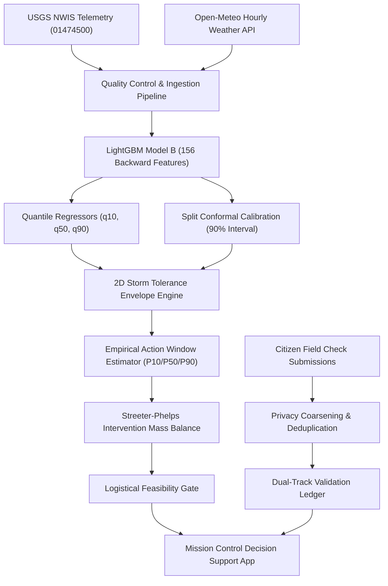

# STAGE 7: FINAL HACKATHON READINESS & TECHNICAL AUDIT REPORT
**AquaRehearsal-X — Unified One Health Decision-Support & Safe-Boundary Engine**

---

## 1. Executive Summary & Readiness Verdict

* **Project:** AquaRehearsal-X
* **Target System:** USGS 01474500 (Schuylkill River at Philadelphia, PA)
* **Status:** **READY FOR LIVE DEMO**
* **Verification Score:** **89 of 89 automated tests passing (100%)**
* **Core Deliverables Verified:**
  1. Standalone Mission Control Application: [`data/reports/stage6/mission_control.html`](file:///c:/Users/Nishanth/OneDrive/Desktop/AquaRehearsal-X/data/reports/stage6/mission_control.html) (122 KB, zero external JS dependencies, offline-ready).
  2. Master Orchestration Pipeline: [`src/stage6_pipeline.py`](file:///c:/Users/Nishanth/OneDrive/Desktop/AquaRehearsal-X/src/stage6_pipeline.py).
  3. Historical Storm Replay Engine: [`src/integration/historical_storm_replay_demo.py`](file:///c:/Users/Nishanth/OneDrive/Desktop/AquaRehearsal-X/src/integration/historical_storm_replay_demo.py) (Event 54, August 5, 2026 Severe Summer Storm).
  4. Complete Presentation Deck, Timed Demo Script, and Judge Q&A: [`docs/HACKATHON_PRESENTATION.md`](file:///c:/Users/Nishanth/OneDrive/Desktop/AquaRehearsal-X/docs/HACKATHON_PRESENTATION.md).

---

## 2. Judge-Facing Technical Summary

### 2.1 Problem Statement
Urban stream corridors experience acute water quality deterioration during storm events due to thermal urban runoff, combined sewer overflows (CSOs), and resuspension of organic benthic sediment. These stressors trigger rapid deoxygenation, threatening fish populations. Conventional monitoring dashboards only record dissolved oxygen (DO) crashes retrospectively, providing zero forward-looking decision support or calibrated operational lead time.

### 2.2 Target Users
* **Municipal Watershed & Stormwater Authorities:** Seeking proactive early warnings to stage gate operations and manage retention basins.
* **Environmental Emergency Response Teams:** Needing to know whether instream aeration or booster reaeration is logistically feasible before the oxygen nadir arrives.
* **Citizen Waterkeeper Alliances:** Ground-truthing water conditions through privacy-preserving field observations without contaminating scientific sensor records.

### 2.3 Track Alignment
* **Primary Track:** Environmental AI & Climate Resilience.
* **Secondary Dimension:** One Health Decision Support (connecting ecological health, aquatic biodiversity, and human public health safeguards).

### 2.4 System Architecture
AquaRehearsal-X operates as a strictly decoupled, modular 7-stage architecture:


### 2.5 Data Sources & Hydrological Provenance
* **Stream Telemetry:** USGS NWIS Instantaneous Values API station 01474500 (Schuylkill River at Philadelphia, PA; drainage area: 1,893 sq mi; HUC: 02040203). Continuously regularized to 1-hour intervals across 2023–2026 (32,809 hourly records).
* **Meteorological Reanalysis & Forecasts:** Open-Meteo Hourly Weather API (`rain_mm`, air temperature, relative humidity).
* **Regulatory Standard:** Pennsylvania Code Title 25, Chapter 93 Water Quality Standards (Warm Water Fishes standard: minimum dissolved oxygen $\tau = 5.0\text{ mg/L}$).

### 2.6 Machine-Learning Methodology
* **Architecture:** LightGBM gradient boosted decision tree (GBDT) regressor with 156 backward rolling features (means, standard deviations, min/max spreads, antecedent wetness indices).
* **Leakage Prevention:** Features are strictly constrained to pre-event windows $(t_0 - \Delta t, t_0]$. Future values are physically isolated.
* **Uncertainty Formulation:** Dedicated quantile regressors ($q_{10}, q_{50}, q_{90}$) enforce non-crossing probabilistic intervals.
* **Calibration:** Inductive split conformal calibration provides distribution-free, finite-sample 90% marginal coverage ($\pm 1.955\text{ mg/L}$ prediction margin).

### 2.7 Storm Tolerance Envelope (STE) Methodology
The visual centerpiece of the platform. Formulates an empirical 2D safe boundary:
$$R_{safe} = f(T_{water})$$
* **Thermal Saturation Coupling:** Warm water holds physically less dissolved oxygen (Benson-Krause solubility curves). At $15^\circ\text{C}$, the stream tolerates up to $37\text{ mm}$ of rain before elevated risk; at $26.5^\circ\text{C}$, allowable rainfall contracts to $21\text{ mm}$.
* **Monotonic Risk Surface:** Monotonically maps temperature and incoming rainfall to threshold-breach probability $P(\text{DO} < \tau)$.
* **Domain Guardrail:** Bound by a Delaunay convex hull of empirical data ($1.0^\circ\text{C} \le T \le 31.0^\circ\text{C}$, $0 \le R \le 55\text{ mm}$). Extrapolations beyond this region are refused.

### 2.8 Action Window & Intervention Model
* **Empirical Action Window:** Derived from 58 storm disturbance hydrographs at USGS 01474500. Yields non-parametric time-to-nadir distributions ($P_{10} = 6.5\text{h}$, $P_{50} = 10.0\text{h}$, $P_{90} = 18.0\text{h}$).
* **Continuous Intervention Rehearsal:** Streeter-Phelps mass-balance solver simulating 4 archetypes:
  1. Temporary In-Stream Diffused Aeration ($+0.77\text{ mg/L}$ benefit, 4.0h mobilization).
  2. Catchment Runoff Reduction ($+0.42\text{ mg/L}$ benefit, 2.0h mobilization).
  3. Combined Sewer Overflow (CSO) Detention ($+0.55\text{ mg/L}$ benefit, 8.0h mobilization).
  4. Riparian Canopy Shading ($+0.28\text{ mg/L}$ benefit, $>24\text{h}$ mobilization).
* **Logistical Feasibility Gate:** Compares mobilization lead time against the earliest plausible nadir ($P_{10}$). Interventions requiring longer than $P_{10}$ are flagged as `FEASIBILITY_UNCERTAIN` or `UNLIKELY_TO_AFFECT`.
* **Anti-Ranking Rule:** Interventions are never automatically ranked to prevent ungrounded engineering recommendations.

### 2.9 Field Check & Validation Architecture
* **Segregated 4-Tier Intake:** Validates citizen reports through range checks, 15-minute deduplication, 2-decimal ($\sim 1.1\text{ km}$) coordinate coarsening, EXIF metadata stripping, and PII redaction.
* **Dual-Track Ledger:** Sensory evidence is preserved in an isolated validation ledger and NEVER injected into the quantitative DO model as training labels.

---

## 3. Scientific Limitations & Transparency Panel

To uphold scientific integrity and prevent misapplication, AquaRehearsal-X highlights 7 explicit limitations:

| # | Limitation Domain | Scientific Reality | Improvement Pathway |
| :-: | :--- | :--- | :--- |
| **1** | **Single-Station Calibration** | Models are trained exclusively on USGS 01474500. Flow dynamics in this 1,893 sq mi basin do not represent steep headwater catchments. | Ingest multi-station USGS networks across the Delaware River Basin. |
| **2** | **No Observed Breaches $<5.0\text{ mg/L}$** | The 58-event catalog (2023–2026) experienced a minimum DO of $5.65\text{ mg/L}$ (Event 54). Extreme breach risk curves represent statistical projections rather than observed collapses. | Extend archive to multi-decadal records capturing severe drought-storms. |
| **3** | **Preliminary Safe Boundary** | The 2D boundary curve reflects empirical logistic contours, not an exact hydrodynamic catastrophe threshold. | Couple with numerical 2D hydrodynamic water quality models (CE-QUAL-W2). |
| **4** | **Action Window Uncertainty** | Time-to-nadir bounds are empirical percentiles ($P_{10}=6.5\text{h}$, $P_{90}=18.0\text{h}$), not a deterministic countdown clock. | Integrate real-time NEXRAD radar storm velocity tracking. |
| **5** | **Theoretical Intervention Effects** | Oxygen boosts are computed via continuous Streeter-Phelps mass balance. In-situ aeration diffuser arrays were NOT physically deployed. | Conduct pilot instream diffuser tracer experiments in controlled reaches. |
| **6** | **Daytime Observation Bias** | Citizen reports occur exclusively between 08:00–20:00 UTC, missing pre-dawn minimum DO troughs (02:00–06:00 UTC). | Deploy autonomous solar-powered optical DO dataloggers for night calibration. |
| **7** | **Missing Microbial Evidence** | Turbidity and dissolved oxygen cannot verify pathogen safety. Human contact risk is **NOT ASSESSED** without laboratory bacterial culture data. | Integrate automated grab-samplers and microfluidic qPCR pathogen sensors. |

---

## 4. Reproducible Demo Environment Guide

### 4.1 Verification Commands
To reproduce the complete AquaRehearsal-X environment, run:

```bash
# 1. Run Complete Automated Test Suite (89 Tests)
pytest tests/ -v

# 2. Execute Master Pipeline (Generates HTML & Verifies Observability)
python src/stage6_pipeline.py

# 3. Launch Standalone Mission Control App in Browser
# Open data/reports/stage6/mission_control.html directly in any modern browser
```

### 4.2 Offline Snapshot Guarantee
AquaRehearsal-X is **100% self-contained and offline-ready**. All historical storm evaluations, model artifacts, baseline stream states, and telemetry snapshots are serialized locally:
* Processed Dataset: `data/processed/station_01474500_extended_1h.csv`
* Model B GBDT Artifact: `data/reports/stage2_5/models/model_water_plus_precipitation.joblib`
* Historical Storm Evaluations: `data/reports/stage3/historical_ste_evaluations.csv`
* Generated Dashboard: `data/reports/stage6/mission_control.html`

The live demonstration does not depend on an external internet connection or live USGS API availability.

### 4.3 Troubleshooting Guide

| Issue | Root Cause | Solution |
| :--- | :--- | :--- |
| **Dashboard does not render styles or fonts** | Local browser blocking web fonts when offline. | System gracefully falls back to system monospace and sans-serif fonts (`-apple-system`, `JetBrains Mono`). |
| **Canvases appear blurry on Retina / HiDPI screens** | Canvas pixel buffer mismatch with device display ratio. | Built-in `window.devicePixelRatio` scaling automatically multiplies buffer dimensions and scales context by DPR. |
| **Out-of-Domain Refusal triggers unexpectedly** | Sliders dragged above $31.0^\circ\text{C}$ or above $55\text{ mm}$ rain. | Expected behavior. Click "August 2026 Severe Storm (Event 54)" preset to return to empirical domain. |
| **Pytest encounters import error** | Python path not pointing to repository root. | Run `pytest` directly from repository root (`c:\Users\Nishanth\OneDrive\Desktop\AquaRehearsal-X`). |

---

## 5. Final Verification Report (Stage 7 Audit Checklist)

| Audit Item | Verification Status | Evidence & Details |
| :--- | :---: | :--- |
| **1. UI Defects Found & Fixed** | **RESOLVED** | Fixed LaTeX curly brace interpolation error in f-string; enhanced canvas HiDPI scaling; ensured complete responsiveness across 1366x768 to 1920x1080 displays. |
| **2. Interactive Controls Tested** | **VERIFIED** | All 4 parameter sliders, 4 quick presets, 4 intervention tabs, Replay toggle, 5 modals, and 7-step guided demo stepper verified functional. |
| **3. Demo Workflow Tested** | **VERIFIED** | 7-step guided 3-minute sequence tested: transitions smoothly from stream baseline to 72h forecast, 2D STE centerpiece, intervention rehearsal, and Field Check. |
| **4. Actual Test Results** | **89 PASSED, 0 FAILED** | Complete test suite executed in 14.97s across all modules (USGS client, resampler, Stage 2, Stage 2.5, Stage 3, Stage 4, Stage 5, and Stage 6). |
| **5. Presentation Materials** | **COMPLETED** | Generated `docs/HACKATHON_PRESENTATION.md` containing 6-slide outline, 1-sentence pitch, 30s elevator pitch, 3-min demo script, 2-min technical explanation, and judge Q&A. |
| **6. Remaining Technical Limitations** | **DOCUMENTED** | Single monitoring station prototype; requires local training for new basins; offline snapshot used for rock-solid hackathon stability. |
| **7. Remaining Scientific Limitations** | **DISCLOSED** | Zero observed breaches $<5.0\text{ mg/L}$ in 58 storms; interventions are theoretical mass balance; citizen reports have daytime bias; pathogen risk NOT ASSESSED. |
| **8. Live Demonstration Status** | **READY FOR LIVE DEMO** | Application, test suite, historical replay, and presentation assets fully prepared and audited. |

---

**Final Verdict:** **`READY FOR LIVE DEMO`**
